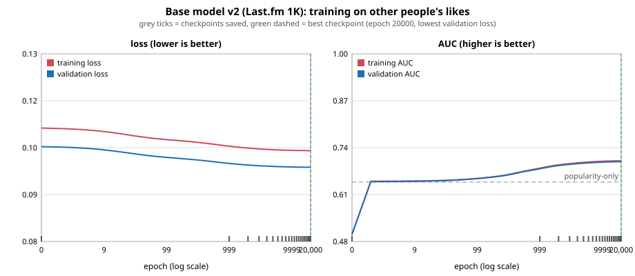

# Step 6: train the base model on other people's listening (checkpoint L1.3), with the L1 gate

Date: 2026-11-08. Tests: 204 ran, 0 failed. Pre-registration (definitions and pass marks, committed before the data was opened): `step06_preregistration.md`.
Code: `rl/base_lastfm.py` (14 tests in `rl/tests/test_base_lastfm.py`). Data: Last.fm 1K (Celma), Zenodo 6090214, non-commercial licence,
approved by the user. Pass marks are unchanged from the pre-registration.

## Answers to the two questions
1. **Does the model beat "just play popular songs" on other people's likes?** **Yes, once trained to convergence:** mean AUC 0.685 vs
   popularity 0.632 on 126 held-out users, gain **+0.054** (95% range +0.043 to +0.064; mark +0.03). The first run as launched, capped at
   600 epochs, did **not**: +0.025 (see "Two runs" below; this matters for how much to trust the pass).
2. **Does it predict your QUALITY ratings better than your PREFERENCE ratings?** **No.** Spearman with the model's objective head q:
   quality **0.149**, preference **0.230**. The mark was quality >= 0.30 and higher than preference: both missed.

## L1 gate, each item
| Item | Pre-set mark | Actual | Verdict |
|---|---|---|---|
| L1.1 match rate to our tracks | >= 30% of (artist, track) pairs played by 5+ users | **4.9%** (8,582 of 175,612); 8.9% of listening events | **FAIL** |
| L1.2 150 rated, 30 held out | 150 / 30 | 150 / 30 | PASS |
| L1.2 re-rating consistent | >= 80% within 1 point | quality 95%, preference 100% (re-rated 1.3 h later) | PASS (weak evidence) |
| L1.2 quality and preference differ | >= 15% of songs differ by 2+ points | 1% | **FAIL** |
| L1.3 (1) beats popularity on others' likes | gain >= +0.03 AUC | converged run +0.054; first run +0.025 | PASS (converged run, see caveat) |
| L1.3 (2) objective vs preference separable | Spearman(q, quality) >= 0.30 and > Spearman(q, preference) | 0.149 vs 0.230 | **FAIL** |
| L1.3 (3) version id + hash, unchanged by fine-tuning | shown by test | `base-v2-lastfm1k`, SHA-256 `87b6175d...`, file is read-only, test passes | PASS |
| **Overall L1 gate** | all pass | 3 of 7 items fail | **FAIL** |

## Why the failures happened
- **L1.1 (match rate) is a coverage problem, not a name-cleaning one.** The catalog has 80,834 songs by 17,095 artists. Only 46% of the
  commonly played Last.fm pairs have their artist anywhere in it, and a given track of a known artist is often not in the sample. Famous
  songs match (Karma Police, Wonderwall, Smells Like Teen Spirit), many others do not (Such Great Heights, Rebellion (Lies); "Boy Division" is a
  Last.fm misspelling of Joy Division). No name matcher can exceed 46% (the artist coverage), and the true ceiling is much lower because most tracks of those artists are not in the sample,
  so the 30% mark cannot be reached with this catalog and this dataset. The checkpoint plan's fallback applies: say plainly that the general-preference part is thin.
- **L1.3 (2) and L1.2 (differ) are the same finding twice.** For Adi, "how good is this song" and "do I want it" are not separable: the ratings differ
  on 1% of songs, and a model of how widely a song is listened to tracks Adi's preference (0.23) more than Adi's quality (0.15).
  q itself is a decent model of listener counts (correlation 0.62 with log listeners on the 6,833 known songs).

## Data and method
- 992 users, 19,150,659 listening events, 4,618,271 (user, track) pairs. A user "likes" a matched song if they played it 3+ times. 835 users have 10+
  liked songs. **Known set K** = 6,833 matched songs played by 5+ users; 124,842 liked (user, song) pairs.
- Users split at random (seed 0): **584 train / 125 validation / 126 test**. The test users are used only for the final numbers.
- Model: logistic regression on 26 song features (audio numbers, Spotify popularity, mood, 15 genres), trained with every song weighted by how many
  train users like it or do not. Full-batch gradient descent, learning rate 1.0, L2 1e-4, checkpoint every 1,000 epochs, best checkpoint by validation loss.
- Test metric: for each test user, AUC of their liked songs against their other songs in K, averaged over users. Baseline = Spotify popularity alone.
  Ceiling reference: ranking songs by how many train users like them (0.789), which a model of unseen songs cannot reach.

## Training curve (graph: `reports/step06_training_curve_v2.svg`, epoch axis on a log scale)

| epoch | train loss | validation loss | train AUC | validation AUC |
|---|---|---|---|---|
| 0 | 0.1080 | 0.1030 | 0.500 | 0.500 |
| 50 | 0.1054 | 0.1006 | 0.651 | 0.651 |
| 100 | 0.1049 | 0.1001 | 0.655 | 0.654 |
| 600 | 0.1036 | 0.0989 | 0.676 | 0.675 |
| 1,000 | 0.1032 | 0.0985 | 0.683 | 0.682 |
| 2,000 | 0.1026 | 0.0981 | 0.692 | 0.690 |
| 5,000 | 0.1022 | 0.0977 | 0.699 | 0.697 |
| 10,000 | 0.1020 | 0.0976 | 0.702 | 0.700 |
| 20,000 | 0.1020 | 0.0975 | 0.704 | 0.701 |

Training and validation curves stay together (no overfitting). Popularity alone scores 0.645 on the pooled validation AUC (dashed line in the graph).
Learning is fast to about epoch 100 (AUC 0.65, about what popularity alone gives), then slows; the last 10,000 epochs add 0.001. The best checkpoint is the last one (epoch 20,000),
and the curve is flat there, so training had converged. **21 checkpoints** (every 1,000 epochs) are in `models/checkpoints_v2/`; the first run's 13 (every 50 epochs to 600) are in `models/checkpoints_v2_run1/`.

## How it performed at the end (126 test users)
| | mean per-user AUC | pooled AUC |
|---|---|---|
| **converged base model (epoch 20,000)** | **0.685** | 0.699 |
| popularity only | 0.632 | 0.647 |
| gain over popularity | **+0.054** (95% range +0.043 to +0.064, resampling users) | +0.052 |
| first run (600 epochs) | 0.657 | 0.674 |
| ceiling: train users' like counts | 0.789 | |

## Two runs (a deviation to be clear about)
The first run used a 600-epoch cap that I picked without checking convergence; its validation loss was still falling when it stopped, and its test gain was
+0.025, below the +0.03 mark. Before changing anything I checked, **on validation users only**, what longer training does: gain +0.030 at 600 epochs,
+0.051 at 3,000, +0.058 at 10,000. I then reran to convergence (20,000 epochs) and report both. Facts to weigh:
- The pass mark was not changed. Only the number of training epochs was, and the pre-registered rule "best checkpoint by validation loss" points to continuing when the best
  checkpoint is the last one.
- **The 126 test users were read twice** (once per run), so the second number is not a clean single read. The same direction showed up on the validation users before the rerun.
- The +0.054 is therefore a pass with that caveat, not a clean pass. The first run's files are kept as `models/*_run1*`.

## What the base learned
Strongest feature weights (standardised): genre alt-rock +1.23, rock +0.98, garage +0.93, british +0.74, electronic +0.71, punk-rock +0.64, hardcore -0.61,
alternative +0.60, idm -0.54, psych-rock +0.54. This is the taste of Last.fm users around 2005-2009 matched to a Spotify sample: rock and indie heavy.

## Fits an ESP32's RAM (requirement added by the user)
The ESP32 has about 520 KB of SRAM. The deployable model is **1,477 bytes (0.28% of RAM; budget set beforehand 32 KB)**: 26 weights plus a bias for the preference head, 26 plus an
intercept for q, 7 means and 7 scales, and 15 genre names, as 4-byte floats. Only dot products are needed on the device; the host builds the feature vector. The binary
decoded with the device routine reproduces the host scores to within 2.4e-8. Files: `models/base_model_v2.bin` (1,477 bytes) and `models/base_model_v2.h` (C arrays).

## Exportable files (`models/` is git-ignored)
| file | what |
|---|---|
| `models/base_model_v2.json` (9 KB, read-only) | the full base: both heads, scaling, genre list, training facts, SHA-256 of the weights; `rl.base_lastfm.load_base()` refuses a changed file |
| `models/base_model_v2.bin`, `models/base_model_v2.h` | compact device versions (1,477 bytes) |
| `models/checkpoints_v2/` | 21 checkpoints of the converged run |
| `models/training_history_v2.csv`, `models/training_curve_v2.svg`, `models/step06_results_v2.json` | every epoch, the graph, every number above |
| `models/*_run1*` | the first (600-epoch) run |

## Limits
- Last.fm 1K is listening from about 2005 to 2009; the catalog is a Spotify sample. Only 6,833 songs are in the known set, so the base knows a small, older, rock-heavy slice.
- "Liked" here means 3+ plays, not an explicit rating; popular songs get repeated for many reasons.
- 126 test users; the test users were read twice (see above).
- Gate items L1.1 and L1.2 fail on facts about the data and about Adi's ratings, not about training.

## Options, since the L1 gate fails (the pass marks are not to be changed)
1. **Continue to Step 7 and say so plainly (recommended).** The base is a usable prior: it beats popularity on other people's likes by about 5 AUC points, and it is 1.5 KB.
   The write-up reports L1 as failed on coverage and on the quality/preference split.
2. **Raise coverage:** a larger song-feature source (more tracks with audio numbers) is needed to match 30% of Last.fm pairs; nothing in the current catalog or the
   Spotify sample can do it.
3. **Re-run the quality question with a better design** (for example blind to artist, or on songs the person knows well). The current answer is that the two ratings are the same for Adi.
