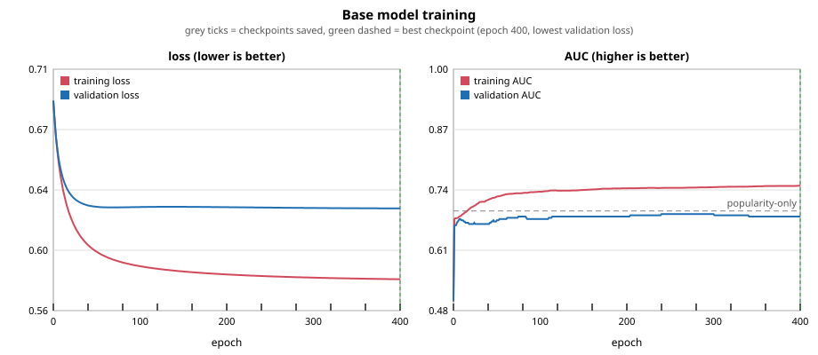

# Step 6b: base model v1 (training run, checkpoints, graph, exportable file)

Date: 2026-11-08. Tests: 190 ran, 0 failed. Code: `rl/base_model.py` (10 tests in `rl/tests/test_base_model.py`).
Command: `python3 -m rl.base_model --user adi`. Training takes about 0.4 seconds.

## What this base model is, and is not
A logistic-regression model of P(thumb up | song) from the song's audio numbers, popularity, mood and genre. It is trained on
**one user's** explicit thumbs (264: 100 liked, 164 disliked; 150 from the camera-agreement sessions, 120 from the live session,
6 songs overlap). Layer 1 was meant to be trained on many people's likes; no such data was available (see step06), so this is
the fallback base. It is a frozen, documented, exportable file, not a model of the crowd.

## Method
- **Split** (stratified by thumb, seed 0): 185 train, 40 validation, 39 test. The test split is never used for training,
  scaling, genre selection or checkpoint choice (tests check this) and was read once at the end.
- **Features (26):** valence, energy, danceability, tempo, acousticness, instrumentalness, popularity (standardised on the training
  songs; a missing value becomes the training mean), 4 mood flags, and 15 genre flags (genres with 5+ training songs).
- **Training:** full-batch gradient descent on log loss, learning rate 0.1, L2 penalty 0.05, 400 epochs, weights start at zero.
- **Checkpoints:** saved every 40 epochs (11 files, epochs 0 to 400) in `models/checkpoints/`. The exported model is the one with the
  lowest validation loss (epoch 400). Checkpoint 0 is the untrained model (every score equal).

## Training curve

| epoch | train loss | validation loss | train AUC | validation AUC |
|---|---|---|---|---|
| 0 | 0.693 | 0.693 | 0.500 | 0.500 |
| 10 | 0.640 | 0.646 | 0.687 | 0.675 |
| 50 | 0.597 | 0.626 | 0.726 | 0.675 |
| 100 | 0.588 | 0.625 | 0.736 | 0.677 |
| 200 | 0.582 | 0.625 | 0.743 | 0.683 |
| 400 | 0.579 | 0.624 | 0.749 | 0.683 |

Reading: almost all learning happens in the first 50 epochs; after that training loss keeps creeping down while validation barely
moves (a small gap, mild overfitting, but no collapse). Validation AUC peaks at 0.688 (epoch 240) and ends at 0.683.
Training took 0.4 s, so there is nothing to stop early.

## How it performed at the end
| | AUC | notes |
|---|---|---|
| training (185 songs) | 0.749 | popularity-only on the same songs: 0.684 |
| validation (40 songs) | 0.683 | popularity-only: 0.695 |
| **test (39 songs, 15 liked)** | **0.786** | **popularity-only: 0.843**; test log loss 0.552 |

**It does not beat popularity-only** on validation or test. With 39 test songs the AUC moves by several points when a single
song is re-ranked, so this is consistent with step08 (popularity-only 0.712 across all 264 thumbs, nothing added helped), not a new
finding. Largest weights: popularity +0.44, instrumentalness -0.30, acousticness -0.29, genre k-pop -0.27, genre dance +0.20,
mood calm +0.17, mood melancholy -0.13.

## The exportable file
`models/base_model_v1.json` (2 KB, one self-contained file): feature names, weights, bias, scaling (means and standard deviations),
the genre list, the training facts (split sizes, epochs, test AUC, best epoch), a version and a SHA-256 of the weights
(`2f1ef59d78f93d49...`). `rl.base_model.load_model(path)` refuses a file whose hash does not match. Anyone can score a song with
only the JSON: `p = sigmoid(sum(w_i * x_i) + bias)` where x is built as in `Featurizer.vector`. Other files: `models/training_history.csv`
(every epoch), `models/training_curve.svg`, `models/checkpoints/*.json`.
**The `models/` folder is git-ignored**: the weights reflect one person's taste, so nothing was pushed. Copy the file out directly
or ask for it to be committed.

## Limits
- One user, 264 thumbs, 39 test songs: every AUC here is known to roughly +/-0.1.
- The thumbs come from mixed selection rules (gym/party, smart order, random, popular, profile-picked), so this is not one random sample.
- Hyper-parameters (learning rate, L2) were not tuned; one setting was run. The validation split was used only to choose the checkpoint.
- Not a base of "general taste": it equals popularity plus a little of one person's preferences.
