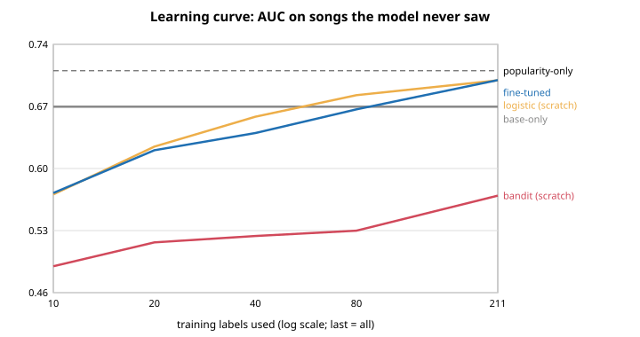

# Step 7: personal layer on the frozen base (L2.1) and fine-tuning on Adi (L2.2)

Date: 2026-11-08. Tests: 215 ran, 0 failed. Pre-registration (design and pass marks, committed before any model was fitted): `step07_preregistration.md`.
Code: `rl/personal_layer.py` (11 tests in `rl/tests/test_personal_layer.py`). Base: `models/base_model_v2.json` (hash `87b6175d...`).
Data: Adi's 264 explicit thumbs (100 liked). The final 30-song test set was **not touched** (it was already spent in Step 4c); evaluation is
repeated 5-fold cross-validation, so every song is scored by a model that never saw it.

## Answer
**The personal layer does not beat the base by the pre-set margin, and does not beat a model trained from scratch on the same labels.
Layer 2 gate: FAIL.** Popularity alone is still the best single predictor of Adi's thumbs.

## Gate, each item
| Item | Pre-set mark | Actual | Verdict |
|---|---|---|---|
| L2.1 (a) zero user data = the base | identical output | exactly equal logits (test) | PASS |
| L2.1 (b) base file unchanged by fine-tuning | bit-for-bit | SHA-256 and file mode identical before/after (test, and checked in the real run) | PASS |
| L2.1 (c) reset returns the base; a different base is refused | exact | exactly equal after reset; mismatched base hash refused (test, and checked in the real run) | PASS |
| L2.2 (a) fine-tuned beats base-only | AUC gain >= +0.05 | **+0.021** (95% range -0.019 to +0.059) | **FAIL** |
| L2.2 (b) fine-tuned beats both from-scratch models | better than bandit and than logistic | beats the bandit by +0.094 (+0.023 to +0.164); vs logistic **-0.008** (-0.039 to +0.021) | **FAIL** |
| L2.2 (c) reaches the from-scratch logistic's full-label AUC with <= 80 labels | AUC at n=80 >= from-scratch at all labels | 0.669 at n=80 vs 0.702 | **FAIL** |
| P0.4 profile save/load (done in Step 6) | pass | pass | PASS |
| **Layer 2 gate** | all pass | | **FAIL** |

## Results (mean pooled out-of-fold AUC, 5 repeats of 5-fold CV; sd over the 5 repeats)
| model | pooled AUC | mean per-fold AUC (robustness check) |
|---|---|---|
| popularity-only | **0.712** | 0.717 |
| base-only (frozen base, no Adi data) | 0.672 | 0.676 |
| bandit from scratch | 0.578 +/- 0.028 | 0.574 |
| logistic from scratch (same features, no base) | 0.694 +/- 0.011 | 0.708 |
| **fine-tuned (base + personal layer)** | **0.686 +/- 0.010** | 0.695 |

Fine-tuned minus popularity: -0.020 (-0.061 to +0.023). Fine-tuned minus base-only: +0.021 (-0.019 to +0.059).
The pooled AUC (pre-registered) mixes scores from five fold-models whose biases differ; the per-fold AUC avoids that and moves the fitted models up by about 0.01. Neither changes any verdict.

## Learning curve (AUC on unseen songs vs number of training labels; penalty fixed beforehand to the most often chosen one)
Graph: `reports/step07_learning_curve.svg`

| training labels | base-only | bandit (scratch) | logistic (scratch) | fine-tuned |
|---|---|---|---|---|
| 10 | 0.672 | 0.491 | 0.572 | 0.574 |
| 20 | 0.672 | 0.518 | 0.627 | 0.622 |
| 40 | 0.672 | 0.525 | 0.660 | 0.642 |
| 80 | 0.672 | 0.531 | 0.685 | 0.669 |
| 211 (all) | 0.672 | 0.571 | 0.702 | 0.702 |

Fine-tuned tracks the from-scratch logistic model; it never gets ahead. With 40 labels or fewer both are **worse than the untouched base** (0.672): a few labels do more harm than good.
Popularity-only (0.712) is above every model at every size.

## What the fine-tuned model changed (the personal layer, 437 bytes)
Extra genres learned for Adi: chill, electro, indian, k-pop, latino, pagode. Largest shifts from the base: genre dancehall +0.88, k-pop -0.78, alt-rock -0.56
(the base loved alt-rock, +1.23, because Last.fm users in 2005-2009 did), mood calm +0.55, popularity +0.52, ambient -0.50, mood melancholy -0.46, alternative +0.42, dance +0.41, piano +0.40.
The penalty chosen in the cross-validation was usually small (0.01 for 13 of 25 folds, up to 100 for 2), i.e. the data pulled the model away from the base rather than staying near it.

## Exploratory (after seeing the result; not part of the verdict)
Choosing the penalty by inner cross-validation at each training size, instead of one fixed value: fine-tuned AUC is 0.623 (10 labels), 0.616 (20), 0.644 (40), 0.677 (80), 0.687 (211).
Still not above the untouched base (0.672) until about 80 labels, and not above popularity anywhere. The weak showing at 10 labels is partly the pooled-AUC effect (each fold refits its own bias).

## Reading
- The Last.fm base is a real prior: with zero Adi data it scores 0.672 on Adi's thumbs (chance is 0.5). But it is **below popularity (0.712)**, and the gain it showed over popularity on other people's likes (+0.054) does **not** transfer to Adi.
- Adding Adi's labels recovers about what a model with no base reaches (0.69-0.70). The base gives no head start beyond itself, and with these labels nothing exceeds popularity.
- This repeats Step 8 (nothing beat popularity on Adi's thumbs) with a better base. The likely reasons: 264 labels from mixed selection rules, a base from a different era and taste (rock/indie, 2005-2009), and Adi's thumbs being driven mostly by how well-known a song is.

## Size (ESP32 limit: hard cap 520 KB, budget 32 KB)
Base 1,477 bytes + personal layer 437 bytes = **1,914 bytes (0.36% of the ESP32's RAM)**.

## Files (`data/` and `models/` are git-ignored)
`data/profiles/adi_personal_v2.json` (the personal layer, records the base hash and refuses a different base), `models/step07_results.json`, `models/step07_perfold.json`, `models/step07_learning_curve.svg`.

## Limits
- 264 labels, one person, mixed selection rules (gym/party, smart order, random/popular/profile-picked), so the AUCs carry roughly +/-0.04.
- The honest final test is a fresh live session on songs Adi has not rated; it has not been run. The final 30-song set is spent.
- Hyper-parameters were not tuned beyond the pre-registered penalty grid.

## Options
1. **Accept the result and update the write-up (recommended).** Layers 1 and 2 are reported as failed; popularity (or the base as a prior) is the robust choice for this user; the real remaining unknowns are the camera signal and a new user.
2. **A fresh live session** comparing popularity-only, base-only and fine-tuned (about 15 minutes). Offline results say popularity should win, so this would mostly confirm.
3. **More labels**: the learning curves are still rising at 211 labels, so a few hundred more thumbs from varied songs would show whether fine-tuning eventually pulls ahead.
